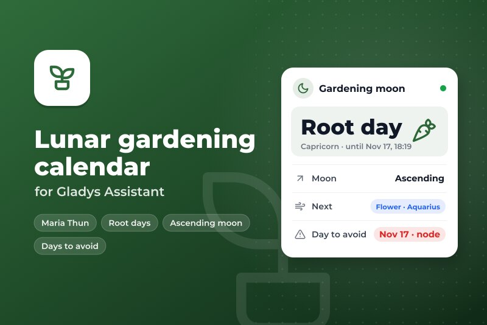
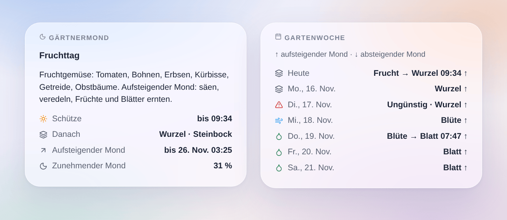
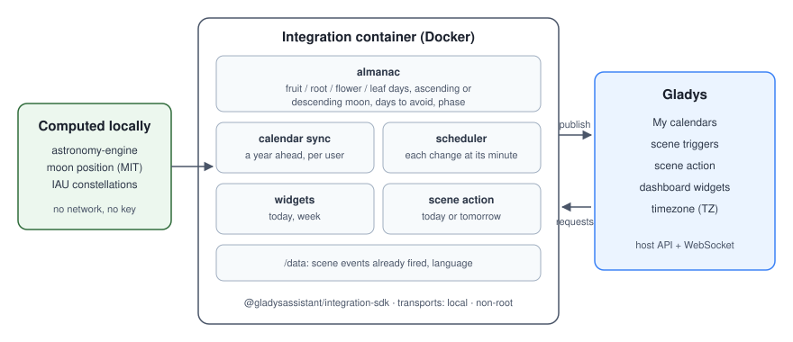
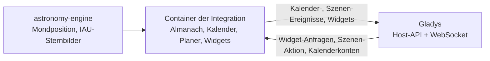
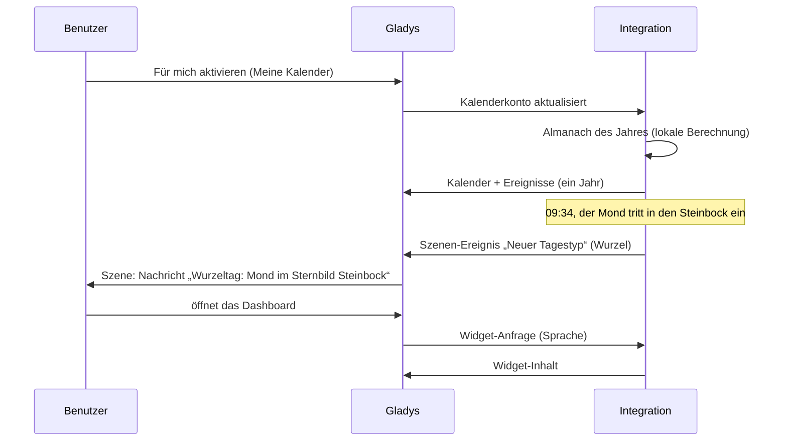

# Gladys Mondkalender für den Garten

[English](README.md) · [Français](README.fr.md) · **Deutsch** · [Español](README.es.md)

[](LICENSE)
[](https://github.com/William-De71/gladys-lunar-gardening-calendar/releases)
[](https://github.com/William-De71/gladys-lunar-gardening-calendar/actions/workflows/release.yml)
[](https://gladysassistant.com)



Externe Integration für [Gladys Assistant](https://gladysassistant.com), die den Mondkalender für den Garten (Methode Maria Thun) in Gladys bringt: Frucht-, Wurzel-, Blüten- und Blatttage, auf- und absteigender Mond, ungünstige Tage. Alles wird lokal aus der Position des Mondes berechnet, ohne Konto und ohne Verbindung, und Tag für Tag mit einem veröffentlichten Kalender verglichen.

Benutzerdokumentation: [English](docs/en.md) · [Français](docs/fr.md) · [Deutsch](docs/de.md) · [Español](docs/es.md).

## Funktionen

- Ein **„Mondkalender für den Garten“** unter „Meine Kalender“ für jeden Benutzer, der ihn aktiviert: ein Ereignis pro Tagestyp, auf die Minute („Wurzeltag · Steinbock“), die Zeiträume des auf- und absteigenden Mondes und die ungünstigen Tage (beide optional), von einer Woche zurück bis ein Jahr voraus, in der Sprache jedes Benutzers.
- Die **echten Sternbilder** des Himmels (IAU-Grenzen), keine 12 Zeichen zu 30°, mit den Durchgängen durch den Schlangenträger wie in den gedruckten Kalendern.
- **Szenen-Auslöser** „Neuer Tagestyp“ und „Neue Mondbahn“ zur Minute des Wechsels, „Tageszusammenfassung“ zu einer gewählten Stunde, mit Filtern. **Szenen-Aktion** „Gartentag abrufen“ (heute oder morgen), mit Tipp und fertigem Satz.
- **Widgets** „Gärtnermond“ (jetzt) und „Gartenwoche“ (eine Zeile pro Tag).
- Nur lokal, vier Sprachen: Englisch, Französisch, Deutsch, Spanisch.



| Art             | Name                        | Verwendung                                                              |
| --------------- | --------------------------- | ----------------------------------------------------------------------- |
| Kalender        | Mondkalender für den Garten | Tagestypen, Mondbahn-Zeiträume, ungünstige Tage, ein Jahr voraus        |
| Widget          | Gärtnermond                 | Der aktuelle Tagestyp und bis wann, der nächste, Mondbahn, Phase, Tipp  |
| Widget          | Gartenwoche                 | 3 bis 10 Tage, je eine Zeile, ungünstige Tage in Rot                    |
| Szenen-Auslöser | Neuer Tagestyp              | Der Mond tritt in das Sternbild eines neuen Typs ein (Filter: Typen)    |
| Szenen-Auslöser | Neue Mondbahn               | Der Mond wird auf- oder absteigend (Filter: Mondbahn)                   |
| Szenen-Auslöser | Tageszusammenfassung        | Jeden Tag zur gewählten Stunde (Filter: Typ, Mondbahn, ungünstiger Tag) |
| Szenen-Aktion   | Gartentag abrufen           | Heute oder morgen: 14 Werte, ein Zusammenfassungssatz und der Tipp      |

Es gibt keine Geräte: Gladys lässt eine Kalender-Integration keine Geräte veröffentlichen, und ein Tagestyp liest sich besser im Kalender, in den Widgets und in den Szenen.

## Funktionsweise







Der Almanach folgt der Methode der biodynamischen Kalender: Das Sternbild des Mondes gibt den Tagestyp (Feuer: Frucht, Erde: Wurzel, Luft: Blüte, Wasser: Blatt), die Deklination den auf- oder absteigenden Mond (um 12 Uhr), und die Tage mit Erdnähe, Erdferne, Mondknoten oder Finsternis sind ungünstig. Durchgänge durch ein Sternbild außerhalb des Tierkreises (jeden Monat der Schlangenträger) behalten das vorherige bis Mitternacht und übernehmen dann das nächste. Verglichen mit den Kalendern 2026 und 2027 von icalendrier.fr: 730 von 730 Tagen (`test/almanac.test.js` behält 2026).

Transport: **lokal**. Nichts verlässt Ihr Netzwerk.

## Voraussetzungen

- Gladys Assistant **5.3.0** oder neuer (Kalender-Integrationen, Katalog-Schlüsselwörter von Gladys 5.3). Ältere Instanzen können sie nicht installieren.
- Die richtige Zeitzone in Gladys: Tage und Uhrzeiten werden darin berechnet.

## Installation

1. Öffnen Sie in Gladys **Integrationen**, suchen Sie **Lunar gardening calendar** und installieren Sie sie.
2. Klicken Sie unter **Meine Kalender** auf **Für mich aktivieren**; teilen Sie den Kalender mit dem Haushalt, um ihn in Szenen zu nutzen.
3. Fügen Sie die Widgets einem Dashboard hinzu und erstellen Sie Szenen mit den Auslösern und der Aktion. Die Einstellungen sind in der [Dokumentation](docs/de.md#konfiguration) beschrieben.

Über die URL des Repositorys oder im Entwicklermodus: siehe die Gladys-Dokumentation zu externen Integrationen.

## Entwicklung

```bash
npm install
npm test                       # node --test, nie mit Netzwerkzugriff
npm run lint && npm run format:check
npx github:GladysAssistant/integration-store . --skip-image-check
scripts/build-cover.sh         # cover.jpg aus docs/assets/cover.svg
docs/illustrations/render.sh   # docs/assets/widgets.<Sprache>.png
node .github/scripts/release.mjs next
```

Lokal liest das SDK `GLADYS_HOST_API_URL`, `GLADYS_INTEGRATION_TOKEN` und `GLADYS_INTEGRATION_SELECTOR`, und `TZ` legt die Zeitzone der Tage fest; `DEBUG=gladys-integration-sdk` gibt die SDK-Protokolle aus und prüft jeden Widget-Inhalt. Die Regeln des Projekts stehen in [CLAUDE.md](CLAUDE.md).

## Release-Prozess


Jeder Merge auf `main` startet die CI und berechnet dann die Version aus den [Conventional Commits](https://www.conventionalcommits.org/de/) seit dem letzten Tag: `feat` → Minor, `fix` / `perf` → Patch, `!` oder `BREAKING CHANGE` → Major (vor 1.0.0 ein Minor); `docs`, `chore`, `ci`, `test`, `style`, `refactor`, `build` allein veröffentlichen nichts. Der Changelog-Abschnitt wird erzeugt, das Tag gepusht, das Multi-Arch-Image gebaut, dann erhält `main` den Release-Commit, das GitHub-Release wird erstellt und ein letzter Job prüft das öffentliche Image, den Store-Validator und das Topic.

- Der Titel des Pull Requests wird zum Squash-Commit und dann zur Changelog-Zeile: Schreiben Sie ihn auf Englisch, für den Benutzer (`pr-title.yml` prüft ihn). Bearbeiten Sie `CHANGELOG.md` nie von Hand.
- 1.0.0 ist eine Entscheidung: Actions → Release → Run workflow mit `release-as: 1.0.0`. `dry-run` zeigt Version und Notizen, ohne etwas zu veröffentlichen.
- **Geschützter Branch**: Rulesets verlangen einen Pull Request auf `main` und sperren die `v*`-Tags; nur der Maintainer und Deploy Keys kommen durch. Das Release pusht mit dem Deploy Key der Umgebung `release` (Secret `RELEASE_DEPLOY_KEY`, nur `main`): Ein Lauf von einem anderen Branch erhält ihn nie. `build.yml` und `github-release.yml` starten nicht bei einem Tag: Das Release ruft sie auf, oder starten Sie sie von Hand (Actions → Run workflow, mit `version` für das Image), um ein Release abzuschließen.
- Machen Sie nach dem ersten Release das `ghcr.io`-Paket öffentlich (Package settings → Change visibility), sonst kann Gladys es nicht herunterladen.

## Mitwirken

Issues und Pull Requests sind willkommen. Führen Sie vor einem Pull Request `npm run format:check && npm run lint && npm test` aus und ändern Sie nie einen gespeicherten Schlüssel (Ereignis-IDs, Schlüssel der Auslöser und der Aktion: siehe [CLAUDE.md](CLAUDE.md)). Ein Tag, der von einem gedruckten Kalender abweicht: Öffnen Sie ein Issue mit dem Kalender, dem Tag und seiner Angabe.

## Sicherheit

Siehe [SECURITY.md](SECURITY.md): Melden Sie Schwachstellen vertraulich. Die Integration hat kein Geheimnis, stellt keine Netzwerkverbindung her und läuft schreibgeschützt, ohne Root-Rechte, in ihrem Container.

## Lizenz

[Apache-2.0](LICENSE). Die Mondposition stammt von [astronomy-engine](https://github.com/cosinekitty/astronomy) (MIT): siehe [NOTICE](NOTICE). Keine Verbindung zu den Verlagen von Maria Thun, Demeter oder icalendrier.fr.
