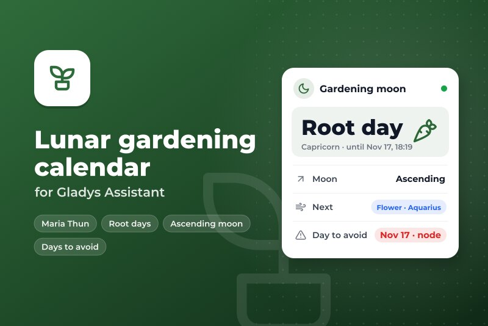
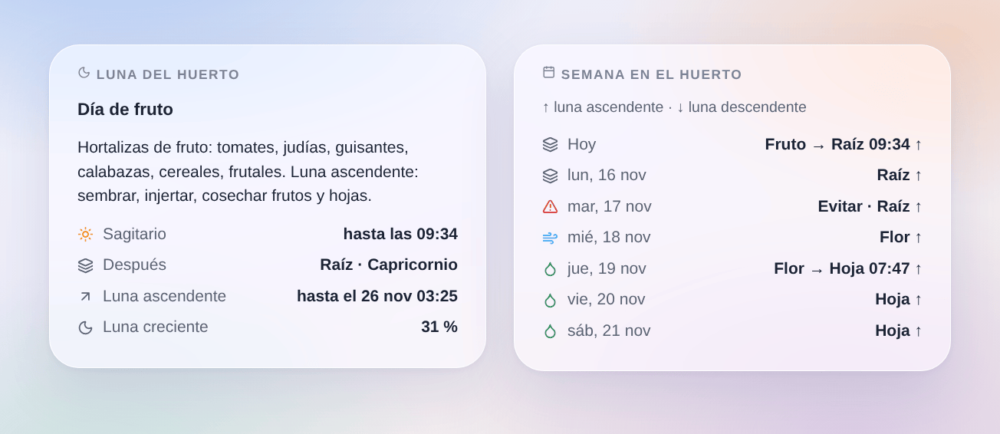
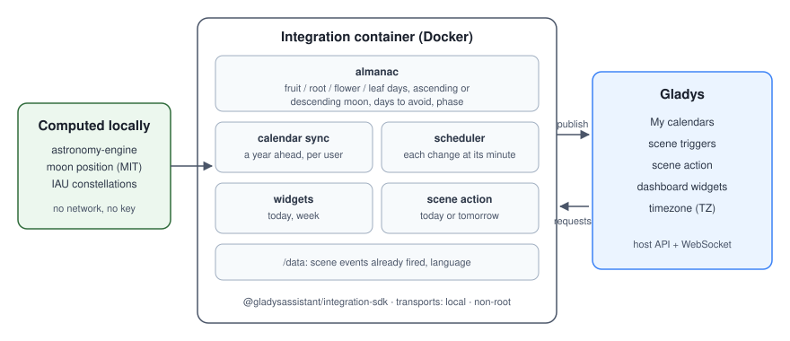
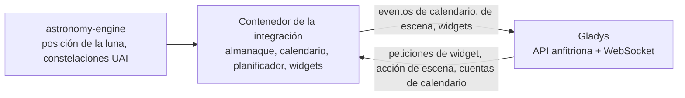
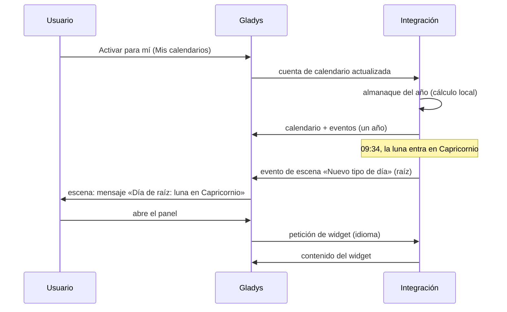

# Gladys Calendario lunar del huerto

[English](README.md) · [Français](README.fr.md) · [Deutsch](README.de.md) · **Español**

[](LICENSE)
[](https://github.com/William-De71/gladys-lunar-gardening-calendar/releases)
[](https://github.com/William-De71/gladys-lunar-gardening-calendar/actions/workflows/release.yml)
[](https://gladysassistant.com)



Integración externa de [Gladys Assistant](https://gladysassistant.com) que trae el calendario lunar del huerto (método Maria Thun) a Gladys: días de fruto, raíz, flor y hoja, luna ascendente y descendente, días desfavorables. Todo se calcula localmente a partir de la posición de la luna, sin cuenta ni conexión, y se comprueba día a día con un calendario publicado.

Documentación de usuario: [English](docs/en.md) · [Français](docs/fr.md) · [Deutsch](docs/de.md) · [Español](docs/es.md).

## Funciones

- Un **«Calendario lunar del huerto»** en «Mis calendarios» para cada usuario que lo active: un evento por tipo de día, al minuto («Día de raíz · Capricornio»), los periodos de luna ascendente y descendente y los días desfavorables (ambos opcionales), de una semana atrás a un año adelante, en el idioma de cada usuario.
- Las **constelaciones reales** del cielo (límites de la UAI), no 12 signos de 30°, con los pasos por Ofiuco tratados como en los calendarios impresos.
- **Disparadores de escena** «Nuevo tipo de día» y «Nueva trayectoria» en el minuto del cambio, «Resumen del día» a la hora elegida, con filtros. **Acción de escena** «Obtener el día de huerto» (hoy o mañana), con el consejo y una frase lista.
- **Widgets** «Luna del huerto» (ahora) y «Semana en el huerto» (una línea por día).
- Solo local, cuatro idiomas: inglés, francés, alemán, español.



| Tipo       | Nombre                      | Uso                                                                            |
| ---------- | --------------------------- | ------------------------------------------------------------------------------ |
| Calendario | Calendario lunar del huerto | Tipos de día, periodos de trayectoria, días desfavorables, un año adelante     |
| Widget     | Luna del huerto             | El tipo de día actual y hasta cuándo, el siguiente, trayectoria, fase, consejo |
| Widget     | Semana en el huerto         | 3 a 10 días, una línea cada uno, días desfavorables en rojo                    |
| Disparador | Nuevo tipo de día           | La luna entra en la constelación de un nuevo tipo (filtro: tipos)              |
| Disparador | Nueva trayectoria           | La luna pasa a ascendente o descendente (filtro: trayectoria)                  |
| Disparador | Resumen del día             | Cada día a la hora elegida (filtros: tipo, trayectoria, día desfavorable)      |
| Acción     | Obtener el día de huerto    | Hoy o mañana: 14 valores, una frase de resumen y el consejo                    |

No hay dispositivos: Gladys no deja que una integración de calendario publique dispositivos, y un tipo de día se lee mejor en el calendario, los widgets y las escenas.

## Funcionamiento







El almanaque sigue el método de los calendarios biodinámicos: la constelación de la luna da el tipo de día (fuego: fruto, tierra: raíz, aire: flor, agua: hoja), la declinación da la luna ascendente o descendente (a mediodía), y los días de perigeo, apogeo, nodo lunar o eclipse son desfavorables. Los pasos por una constelación fuera del zodiaco (Ofiuco cada mes) conservan la anterior hasta medianoche y luego toman la siguiente. Comparado con los calendarios 2026 y 2027 de icalendrier.fr: 730 días de 730 (`test/almanac.test.js` conserva 2026).

Transporte: **local**. Nada sale de su red.

## Requisitos

- Gladys Assistant **5.3.0** o posterior (integraciones de calendario, palabras clave del catálogo de Gladys 5.3). Las instancias más antiguas no pueden instalarla.
- La zona horaria correcta en Gladys: los días y las horas se calculan en ella.

## Instalación

1. En Gladys, abra **Integraciones**, busque **Lunar gardening calendar** e instálela.
2. Haga clic en **Activar para mí** en **Mis calendarios**; comparta el calendario con el hogar para usarlo en escenas.
3. Añada los widgets a un panel y cree escenas con los disparadores y la acción. Los ajustes se describen en la [documentación](docs/es.md#configuración).

Desde la URL del repositorio, o en modo desarrollador: vea la documentación de Gladys sobre integraciones externas.

## Desarrollo

```bash
npm install
npm test                       # node --test, nunca toca la red
npm run lint && npm run format:check
npx github:GladysAssistant/integration-store . --skip-image-check
scripts/build-cover.sh         # cover.jpg desde docs/assets/cover.svg
docs/illustrations/render.sh   # docs/assets/widgets.<idioma>.png
node .github/scripts/release.mjs next
```

En local, el SDK lee `GLADYS_HOST_API_URL`, `GLADYS_INTEGRATION_TOKEN` y `GLADYS_INTEGRATION_SELECTOR`, y `TZ` fija la zona horaria de los días; `DEBUG=gladys-integration-sdk` muestra los registros del SDK y comprueba cada contenido de widget. Las reglas del proyecto están en [CLAUDE.md](CLAUDE.md).

## Proceso de publicación


Cada fusión en `main` lanza la CI y luego calcula la versión a partir de los [Conventional Commits](https://www.conventionalcommits.org/es/) desde la última etiqueta: `feat` → menor, `fix` / `perf` → parche, `!` o `BREAKING CHANGE` → mayor (una menor antes de 1.0.0); `docs`, `chore`, `ci`, `test`, `style`, `refactor`, `build` solos no publican nada. Se genera la sección del changelog, se envía la etiqueta, se construye la imagen multiarquitectura, luego `main` recibe el commit de publicación, se crea la GitHub Release y un último job comprueba la imagen pública, el validador del store y el topic.

- El título de la pull request se convierte en el commit squash y luego en la línea del changelog: escríbalo en inglés, para el usuario (`pr-title.yml` lo comprueba). No edite nunca `CHANGELOG.md` a mano.
- 1.0.0 es una decisión: Actions → Release → Run workflow con `release-as: 1.0.0`. `dry-run` muestra la versión y las notas sin publicar nada.
- **Rama protegida**: unos rulesets exigen una pull request en `main` y bloquean las etiquetas `v*`; solo pasan el mantenedor y las deploy keys. La publicación hace push con la deploy key del entorno `release` (secreto `RELEASE_DEPLOY_KEY`, solo `main`): una ejecución lanzada desde otra rama nunca la obtiene. `build.yml` y `github-release.yml` no arrancan con una etiqueta: la publicación los llama, o lánzelos a mano (Actions → Run workflow, con `version` para la imagen) para terminar una publicación.
- Tras la primera publicación, haga público el paquete `ghcr.io` (Package settings → Change visibility); si no, Gladys no puede descargarlo.

## Contribuir

Issues y pull requests bienvenidas. Ejecute `npm run format:check && npm run lint && npm test` antes de abrir una pull request, y no cambie nunca una clave almacenada (identificadores de eventos, claves de los disparadores y de la acción: vea [CLAUDE.md](CLAUDE.md)). Un día distinto de un calendario impreso: abra un issue con el calendario, el día y lo que indica.

## Seguridad

Vea [SECURITY.md](SECURITY.md): informe de las vulnerabilidades en privado. La integración no tiene ningún secreto, no hace ninguna llamada de red y se ejecuta en solo lectura, sin derechos de root, en su contenedor.

## Licencia

[Apache-2.0](LICENSE). La posición de la luna viene de [astronomy-engine](https://github.com/cosinekitty/astronomy) (MIT): vea [NOTICE](NOTICE). Sin relación con las editoriales de Maria Thun, Demeter ni icalendrier.fr.
