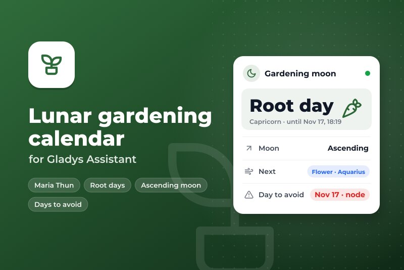
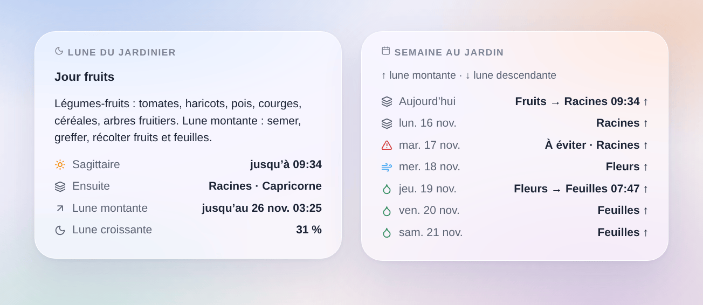
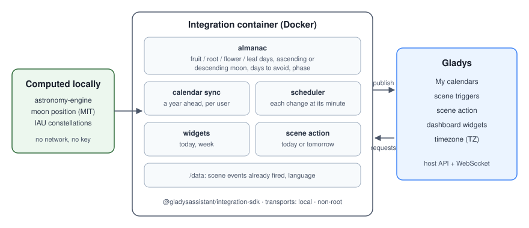
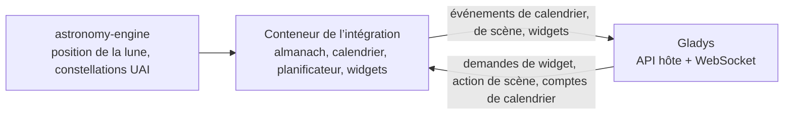
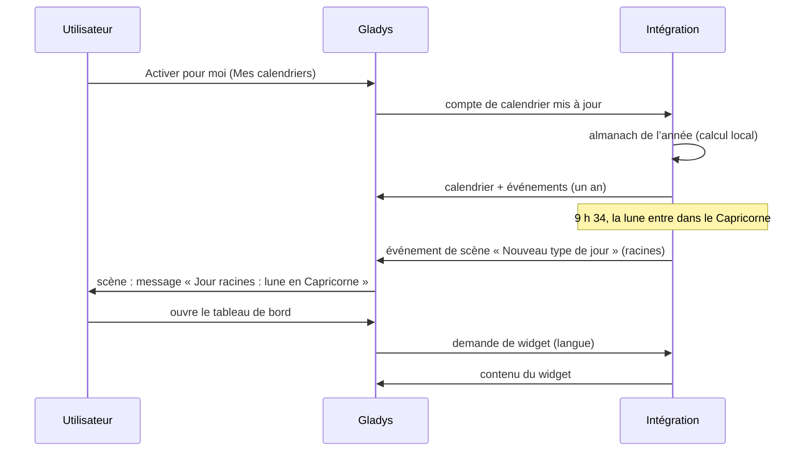

# Gladys Calendrier lunaire du jardinier

[English](README.md) · **Français** · [Deutsch](README.de.md) · [Español](README.es.md)

[](LICENSE)
[](https://github.com/William-De71/gladys-lunar-gardening-calendar/releases)
[](https://github.com/William-De71/gladys-lunar-gardening-calendar/actions/workflows/release.yml)
[](https://gladysassistant.com)



Intégration externe de [Gladys Assistant](https://gladysassistant.com) qui apporte le calendrier lunaire du jardinier (méthode Maria Thun) dans Gladys : jours fruits, racines, fleurs et feuilles, lune montante et descendante, jours à éviter. Tout est calculé localement à partir de la position de la lune, sans compte ni connexion, et vérifié jour par jour avec un calendrier publié.

Documentation utilisateur : [English](docs/en.md) · [Français](docs/fr.md) · [Deutsch](docs/de.md) · [Español](docs/es.md).

## Fonctionnalités

- Un **« Calendrier lunaire du jardinier »** dans « Mes calendriers » pour chaque utilisateur qui l’active : un événement par type de jour, à la minute (« Jour racines · Capricorne »), les périodes de lune montante et descendante et les jours à éviter (facultatifs), d’une semaine en arrière à un an en avant, dans la langue de chaque utilisateur.
- Les **vraies constellations** du ciel (limites de l’UAI), pas 12 signes de 30°, avec les passages d’Ophiuchus traités comme dans les calendriers imprimés.
- **Déclencheurs de scène** « Nouveau type de jour » et « Nouvelle trajectoire » à la minute du changement, « Résumé du jour » à l’heure choisie, avec des filtres. **Action de scène** « Obtenir le jour de jardinage » (aujourd’hui ou demain), avec le conseil et une phrase toute prête.
- **Widgets** « Lune du jardinier » (en ce moment) et « Semaine au jardin » (une ligne par jour).
- Local uniquement, quatre langues : anglais, français, allemand, espagnol.



| Type        | Nom                             | Usage                                                                              |
| ----------- | ------------------------------- | ---------------------------------------------------------------------------------- |
| Calendrier  | Calendrier lunaire du jardinier | Types de jour, périodes de trajectoire, jours à éviter, sur un an                  |
| Widget      | Lune du jardinier               | Le type de jour en cours et jusqu’à quand, le suivant, trajectoire, phase, conseil |
| Widget      | Semaine au jardin               | 3 à 10 jours, une ligne chacun, jours à éviter en rouge                            |
| Déclencheur | Nouveau type de jour            | La lune entre dans la constellation d’un nouveau type (filtre : types)             |
| Déclencheur | Nouvelle trajectoire            | La lune devient montante ou descendante (filtre : trajectoire)                     |
| Déclencheur | Résumé du jour                  | Chaque jour à l’heure choisie (filtres : type, trajectoire, jour à éviter)         |
| Action      | Obtenir le jour de jardinage    | Aujourd’hui ou demain : 14 valeurs, une phrase de résumé et le conseil             |

Il n’y a pas d’appareils : Gladys ne laisse pas une intégration de calendrier publier des appareils, et un type de jour se lit mieux dans le calendrier, les widgets et les scènes.

## Fonctionnement







L’almanach suit la méthode des calendriers biodynamiques : la constellation de la lune donne le type de jour (feu : fruits, terre : racines, air : fleurs, eau : feuilles), la déclinaison donne la lune montante ou descendante (à midi), et les jours de périgée, d’apogée, de nœud lunaire ou d’éclipse sont à éviter. Les passages dans une constellation hors du zodiaque (Ophiuchus chaque mois) gardent la précédente jusqu’à minuit, puis prennent la suivante. Vérifié avec les calendriers 2026 et 2027 d’icalendrier.fr : 730 jours sur 730 (`test/almanac.test.js` garde 2026).

Transport : **local**. Rien ne sort de votre réseau.

## Prérequis

- Gladys Assistant **5.3.0** ou plus récent (intégrations de calendrier, mots-clés du catalogue de Gladys 5.3). Les instances plus anciennes ne peuvent pas l’installer.
- Le bon fuseau horaire dans Gladys : les jours et les heures sont calculés dans ce fuseau.

## Installation

1. Dans Gladys, ouvrez **Intégrations**, cherchez **Lunar gardening calendar** et installez-la.
2. Cliquez sur **Activer pour moi** sous **Mes calendriers** ; partagez le calendrier avec le foyer pour l’utiliser dans les scènes.
3. Ajoutez les widgets à un tableau de bord, et créez des scènes avec les déclencheurs et l’action. Les réglages sont décrits dans la [documentation](docs/fr.md#configuration).

Depuis l’URL du dépôt, ou en mode développeur : voir la documentation de Gladys sur les intégrations externes.

## Développement

```bash
npm install
npm test                       # node --test, ne touche jamais le réseau
npm run lint && npm run format:check
npx github:GladysAssistant/integration-store . --skip-image-check
scripts/build-cover.sh         # cover.jpg depuis docs/assets/cover.svg
docs/illustrations/render.sh   # docs/assets/widgets.<langue>.png
node .github/scripts/release.mjs next
```

En local, le SDK lit `GLADYS_HOST_API_URL`, `GLADYS_INTEGRATION_TOKEN` et `GLADYS_INTEGRATION_SELECTOR`, et `TZ` fixe le fuseau des jours ; `DEBUG=gladys-integration-sdk` affiche les journaux du SDK et vérifie chaque contenu de widget. Les règles du projet sont dans [CLAUDE.md](CLAUDE.md).

## Processus de release


Chaque fusion sur `main` lance la CI, puis calcule la version à partir des [Conventional Commits](https://www.conventionalcommits.org/fr/) depuis le dernier tag : `feat` → mineure, `fix` / `perf` → correctif, `!` ou `BREAKING CHANGE` → majeure (mineure avant 1.0.0) ; `docs`, `chore`, `ci`, `test`, `style`, `refactor`, `build` seuls ne publient rien. La section du changelog est générée, le tag poussé, l’image multi-architecture construite, puis `main` reçoit le commit de release, la GitHub Release est créée et un dernier job vérifie l’image publique, le validateur du store et le topic.

- Le titre de la pull request devient le commit squash, puis la ligne du changelog : écrivez-le en anglais, pour l’utilisateur (`pr-title.yml` le vérifie). Ne modifiez jamais `CHANGELOG.md` à la main.
- 1.0.0 est une décision : Actions → Release → Run workflow avec `release-as: 1.0.0`. `dry-run` affiche la version et les notes sans rien publier.
- **Branche protégée** : des rulesets imposent une pull request sur `main` et verrouillent les tags `v*` ; seuls le mainteneur et les deploy keys passent. La release pousse avec la deploy key de l’environnement `release` (secret `RELEASE_DEPLOY_KEY`, `main` seulement) : un run lancé depuis une autre branche ne l’obtient jamais. `build.yml` et `github-release.yml` ne démarrent pas sur un tag : la release les appelle, ou lancez-les à la main (Actions → Run workflow, avec `version` pour l’image) pour terminer une release.
- Après la première release, rendez public le package `ghcr.io` (Package settings → Change visibility), sinon Gladys ne peut pas le télécharger.

## Contribuer

Issues et pull requests bienvenues. Lancez `npm run format:check && npm run lint && npm test` avant d’ouvrir une pull request, et ne changez jamais une clé stockée (identifiants d’événements, clés des déclencheurs et de l’action : voir [CLAUDE.md](CLAUDE.md)). Un jour différent d’un calendrier imprimé : ouvrez une issue avec le calendrier, le jour et ce qu’il indique.

## Sécurité

Voir [SECURITY.md](SECURITY.md) : signalez les vulnérabilités en privé. L’intégration n’a aucun secret, ne fait aucun appel réseau et tourne en lecture seule, sans droits root, dans son conteneur.

## Licence

[Apache-2.0](LICENSE). La position de la lune vient d’[astronomy-engine](https://github.com/cosinekitty/astronomy) (MIT) : voir [NOTICE](NOTICE). Sans lien avec les éditeurs de Maria Thun, Demeter ou icalendrier.fr.
