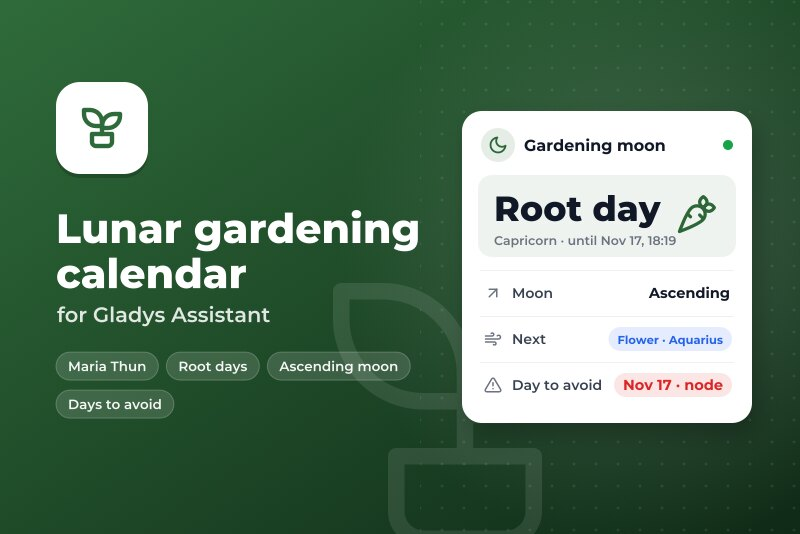
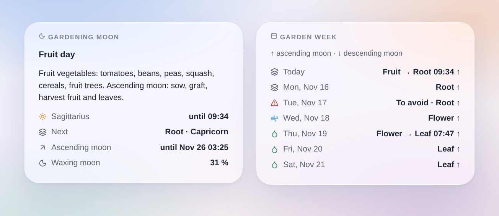
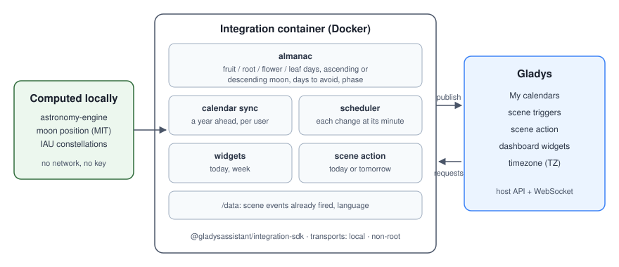
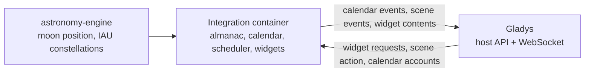
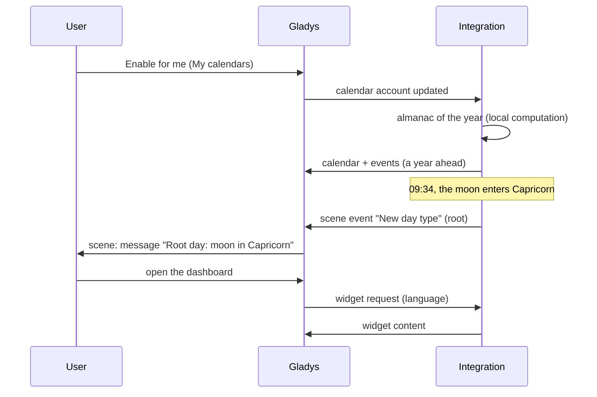

# Gladys Lunar gardening calendar

**English** · [Français](README.fr.md) · [Deutsch](README.de.md) · [Español](README.es.md)

[](LICENSE)
[](https://github.com/William-De71/gladys-lunar-gardening-calendar/releases)
[](https://github.com/William-De71/gladys-lunar-gardening-calendar/actions/workflows/release.yml)
[](https://gladysassistant.com)



[Gladys Assistant](https://gladysassistant.com) external integration bringing the lunar gardening calendar (Maria Thun method) into Gladys: fruit, root, flower and leaf days, ascending and descending moon, days to avoid. Everything is computed locally from the position of the moon, without an account or a connection, and checked day by day against a published calendar.

User documentation: [English](docs/en.md) · [Français](docs/fr.md) · [Deutsch](docs/de.md) · [Español](docs/es.md).

## Features

- A **"Lunar gardening calendar"** in "My calendars" for every user who enables it: one event per day type, to the minute ("Root day · Capricorn"), the ascending and descending periods and the days to avoid (both optional), from a week back to a year ahead, in the language of each user.
- The **real constellations** of the sky (IAU boundaries), not 12 signs of 30°, with the crossings of Ophiuchus handled like the printed calendars.
- **Scene triggers** "New day type" and "New moon trajectory" at the minute of the change, "Daily summary" at a chosen hour, with filters. **Scene action** "Get the gardening day" (today or tomorrow), with the advice and a ready-made sentence.
- **Widgets** "Gardening moon" (now) and "Garden week" (one line a day).
- Local only, four languages: English, French, German, Spanish.



| Kind          | Name                     | Use                                                                      |
| ------------- | ------------------------ | ------------------------------------------------------------------------ |
| Calendar      | Lunar gardening calendar | Day types, trajectory periods, days to avoid, a year ahead               |
| Widget        | Gardening moon           | The day type now and until when, the next one, trajectory, phase, advice |
| Widget        | Garden week              | 3 to 10 days, one line each, days to avoid in red                        |
| Scene trigger | New day type             | The moon enters the constellation of a new day type (filter: types)      |
| Scene trigger | New moon trajectory      | The moon turns ascending or descending (filter: trajectory)              |
| Scene trigger | Daily summary            | Every day at a chosen hour (filters: type, trajectory, day to avoid)     |
| Scene action  | Get the gardening day    | Today or tomorrow: 14 values, a summary sentence and the advice          |

There are no devices: Gladys does not let a calendar integration publish devices, and a day type is better read in the calendar, the widgets and the scenes.

## How it works







The almanac follows the method of the biodynamic calendars: the constellation of the moon gives the day type (fire: fruit, earth: root, air: flower, water: leaf), the declination gives the ascending or descending moon (at noon), and the days of a perigee, an apogee, a lunar node or an eclipse are to avoid. Crossings of a constellation outside the zodiac (Ophiuchus every month) keep the previous one until midnight, then take the next one. Checked against the 2026 and 2027 calendars of icalendrier.fr: 730 days out of 730 (`test/almanac.test.js` keeps 2026).

Transport: **local**. Nothing leaves your network.

## Requirements

- Gladys Assistant **5.3.0** or later (calendar integrations, catalog keywords of Gladys 5.3). Older instances cannot install it.
- The right timezone in Gladys: days and hours are computed in it.

## Installation

1. In Gladys, open **Integrations**, find **Lunar gardening calendar** and install it.
2. Click **Enable for me** under **My calendars**; share the calendar with the household to use it in scenes.
3. Add the widgets to a dashboard, and create scenes with the triggers and the action. The settings are described in the [documentation](docs/en.md#configuration).

From the repository URL, or in developer mode: see the Gladys documentation on external integrations.

## Development

```bash
npm install
npm test                       # node --test, never touches the network
npm run lint && npm run format:check
npx github:GladysAssistant/integration-store . --skip-image-check
scripts/build-cover.sh         # cover.jpg from docs/assets/cover.svg
docs/illustrations/render.sh   # docs/assets/widgets.<lang>.png
node .github/scripts/release.mjs next
```

Locally, the SDK reads `GLADYS_HOST_API_URL`, `GLADYS_INTEGRATION_TOKEN` and `GLADYS_INTEGRATION_SELECTOR`, and `TZ` sets the timezone of the days; `DEBUG=gladys-integration-sdk` prints the SDK logs and checks every widget content. The rules of the project are in [CLAUDE.md](CLAUDE.md).

## Release process


Every merge on `main` runs the CI, then computes the version from the [Conventional Commits](https://www.conventionalcommits.org/) since the last tag: `feat` → minor, `fix` / `perf` → patch, `!` or `BREAKING CHANGE` → major (a minor before 1.0.0); `docs`, `chore`, `ci`, `test`, `style`, `refactor`, `build` alone publish nothing. The changelog section is generated, the tag pushed, the multi-arch image built, then `main` receives the release commit, the GitHub Release is created and a last job checks the public image, the store validator and the topic.

- The pull request title becomes the squash commit, then the changelog line: write it in English, for the user (`pr-title.yml` checks it). Never edit `CHANGELOG.md` by hand.
- 1.0.0 is a decision: Actions → Release → Run workflow with `release-as: 1.0.0`. `dry-run` shows the version and the notes without publishing anything.
- **Protected branch**: rulesets require a pull request on `main` and lock the `v*` tags; only the maintainer and deploy keys get through. The release pushes with the deploy key of the `release` environment (secret `RELEASE_DEPLOY_KEY`, `main` only): a run from another branch never gets it. `build.yml` and `github-release.yml` do not start on a tag: the release calls them, or run them by hand (Actions → Run workflow, with `version` for the image) to finish a release.
- After the first release, make the `ghcr.io` package public (Package settings → Change visibility), otherwise Gladys cannot download it.

## Contributing

Issues and pull requests welcome. Run `npm run format:check && npm run lint && npm test` before opening a pull request, and never change a stored key (event ids, trigger and action keys: see [CLAUDE.md](CLAUDE.md)). A day that differs from a printed calendar: open an issue with the calendar, the day and what it prints.

## Security

See [SECURITY.md](SECURITY.md): report vulnerabilities privately. The integration has no secret, makes no network call, and runs read-only, without root rights, in its container.

## License

[Apache-2.0](LICENSE). The moon position comes from [astronomy-engine](https://github.com/cosinekitty/astronomy) (MIT): see [NOTICE](NOTICE). Not affiliated with the Maria Thun publishers, Demeter or icalendrier.fr.
