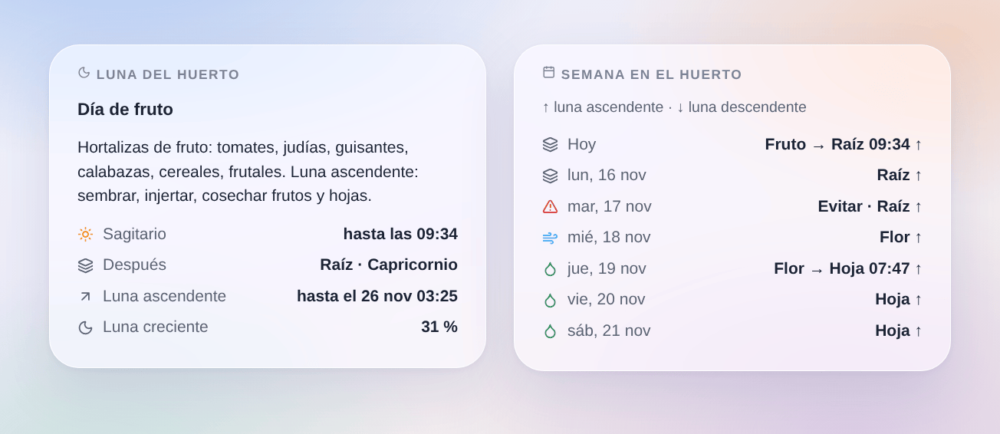

# Calendario lunar del huerto

## Presentación

El calendario lunar del huerto (el método de los calendarios de siembra biodinámicos de Maria Thun) en Gladys, calculado en la propia integración: sin cuenta, sin clave, sin conexión.

- **Días de fruto, raíz, flor y hoja**: el tipo de día sigue la constelación en la que está la luna (constelaciones de fuego, tierra, aire y agua), al minuto.
- **Luna ascendente y descendente**: unos 13,6 días cada una, independientemente de la fase. Ascendente: sembrar, injertar, cosechar frutos y hojas. Descendente: plantar, trasplantar, podar, trabajar la tierra.
- **Días desfavorables**: los días de perigeo, apogeo, nodo lunar o eclipse.

Obtiene un calendario en **Mis calendarios**, dos widgets de panel, tres disparadores de escena y una acción de escena.

## Requisitos

- Gladys Assistant 5.3.0 o posterior.
- La zona horaria correcta en Gladys (Ajustes → Sistema): los días y las horas se calculan en ella.

## Configuración

1. Instale la integración desde **Integraciones** (Lunar gardening calendar).
2. En **Mis calendarios**, haga clic en **Activar para mí**: el «Calendario lunar del huerto» aparece en sus calendarios. Para usarlo en escenas, ábralo en **Calendarios** y compártalo con el hogar.
3. Elija lo que muestra el calendario y la hora del resumen del día:

| Campo                                          | Por defecto | Efecto                                                                             |
| ---------------------------------------------- | ----------- | ---------------------------------------------------------------------------------- |
| Luna ascendente y descendente en el calendario | sí          | Un evento por periodo, de unos 13 días.                                            |
| Días desfavorables en el calendario            | sí          | Un evento de día completo los días de perigeo, apogeo, nodo lunar o eclipse.       |
| Hora del resumen del día                       | 7           | El disparador «Resumen del día» se inicia cada día a esta hora (0 a 23).           |
| Idioma de los textos                           | Automático  | Textos de escenas y estado. El calendario sigue siempre el idioma de cada usuario. |

## Uso

### Calendario

- «Día de raíz · Capricornio» del domingo a las 09:34 al martes a las 18:19: un evento por tipo de día, con las hortalizas de ese tipo en su descripción.
- «Luna ascendente» y «Luna descendente»: un evento por periodo.
- «Día desfavorable: Nodo ascendente 12:47»: un evento de día completo, como en los calendarios impresos, que marcan el día entero.

El calendario cubre la semana pasada y el año siguiente. Avanza cada noche.

### Widgets

- **Luna del huerto**: el tipo de día actual y hasta cuándo, el siguiente, la trayectoria y hasta cuándo, la fase, el día desfavorable y qué hacer.
- **Semana en el huerto**: una línea por día (3 a 10 días, ajuste «Días»): los tipos de día y la hora del cambio, ↑ luna ascendente o ↓ descendente, y los días desfavorables en rojo.

### Escenas

Disparadores:

- **Nuevo tipo de día**: cuando la luna entra en la constelación de un nuevo tipo de día. Filtro: los tipos de día. Variables: `day_type` (fruit, root, flower, leaf), `day_type_label`, `constellation`, `ends_at`, `summary`, `advice`.
- **Nueva trayectoria**: cuando la luna pasa a ascendente o descendente. Filtro: la trayectoria. Variables: `trajectory` (ascending, descending), `trajectory_label`, `ends_at`, `summary`, `advice`.
- **Resumen del día**: cada día a la hora de la configuración. Filtros: el tipo de día principal de la jornada, la trayectoria, día desfavorable o no. Variables: los mismos valores que la acción de abajo.

Acción **Obtener el día de huerto** (hoy o mañana): `date`, `day_type`, `day_type_label`, `day_types` («Fruto hasta las 09:34, luego Raíz»), `constellation`, `trajectory`, `trajectory_label`, `avoid` (yes, no), `avoid_reasons`, `phase` (waxing, waning), `phase_label`, `illumination` (%), `summary`, `advice`.

Ejemplos:

- Cada tarde a las 20:00 (escena programada) → «Obtener el día de huerto» (mañana) → enviar sus salidas «Frase de resumen» y «Consejo de jardinería» en un mensaje.
- «Resumen del día», filtros tipo de día = raíz y día desfavorable = no → enviar «{{triggerEvent.data.summary}} {{triggerEvent.data.advice}}».
- «Nueva trayectoria», filtro descendente → enviar «{{triggerEvent.data.advice}}» (plantar, trasplantar, podar…).

### Transporte

Solo local: todo se calcula en el contenedor, nada sale de su red. El catálogo muestra la insignia «local».

## Cómo se calcula

- La posición de la luna viene de [astronomy-engine](https://github.com/cosinekitty/astronomy) (MIT), precisa a unos segundos de arco.
- Las constelaciones son las reales del cielo (límites de la UAI), de tamaños desiguales, y no 12 signos de 30°. Fuego (Aries, Leo, Sagitario): fruto. Tierra (Tauro, Virgo, Capricornio): raíz. Aire (Géminis, Libra, Acuario): flor. Agua (Cáncer, Escorpio, Piscis): hoja.
- La luna también cruza Ofiuco cada mes, y a veces Auriga, Orión, Cetus o Sextante. Como en los calendarios impresos, estos pasos conservan la constelación anterior hasta la medianoche y luego toman la siguiente.
- La luna ascendente o descendente de un día es la del mediodía. Los días desfavorables son los días locales de un perigeo, un apogeo, un nodo lunar o un eclipse (eclipses lunares penumbrales incluidos).
- Comparado día a día con los calendarios 2026 y 2027 publicados por icalendrier.fr: 730 días de 730, y los mismos minutos cuando los indica.

## Solución de problemas

- **No hay calendario**: haga clic en **Activar para mí** en **Mis calendarios** en la página de la integración. Un calendario no compartido no aparece en las escenas: compártalo con el hogar.
- **Horas desplazadas una o dos horas**: compruebe la zona horaria de Gladys (Ajustes → Sistema) y reinicie la integración.
- **Un día difiere de su calendario de papel**: no todos los calendarios usan los mismos límites (algunos toman 12 signos de 30°, otros reparten Ofiuco de otra forma) ni los mismos días desfavorables. Abra un issue con el calendario, el día y lo que indica.
- **El resumen del día no se inicia**: se inicia una vez al día, a la hora configurada o en el primer minuto siguiente. No se vuelve a iniciar tras un reinicio el mismo día.
- Registros: la pestaña **Registros** de la integración. En modo desarrollador, `DEBUG=gladys-integration-sdk` añade los registros del SDK.
