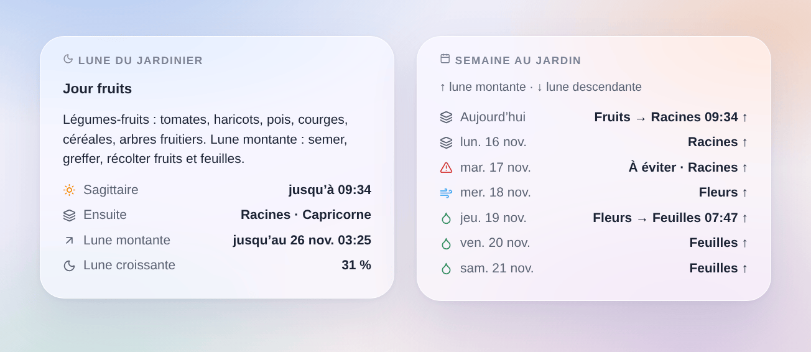

# Calendrier lunaire du jardinier

## Présentation

Le calendrier lunaire du jardinier (la méthode des calendriers des semis biodynamiques de Maria Thun) dans Gladys, calculé dans l’intégration elle-même : aucun compte, aucune clé, aucune connexion.

- **Jours fruits, racines, fleurs et feuilles** : le type du jour suit la constellation où se trouve la lune (constellations de feu, de terre, d’air et d’eau), à la minute près.
- **Lune montante et descendante** : environ 13,6 jours chacune, indépendamment de la phase. Montante : semer, greffer, récolter fruits et feuilles. Descendante : planter, repiquer, tailler, travailler le sol.
- **Jours à éviter** : les jours de périgée, d’apogée, de nœud lunaire ou d’éclipse.

Vous obtenez un calendrier dans **Mes calendriers**, deux widgets de tableau de bord, trois déclencheurs de scène et une action de scène.

## Prérequis

- Gladys Assistant 5.3.0 ou plus récent.
- Le bon fuseau horaire dans Gladys (Paramètres → Système) : les jours et les heures sont calculés dans ce fuseau.

## Configuration

1. Installez l’intégration depuis **Intégrations** (Lunar gardening calendar).
2. Sous **Mes calendriers**, cliquez sur **Activer pour moi** : le « Calendrier lunaire du jardinier » apparaît dans vos calendriers. Pour l’utiliser dans les scènes, ouvrez-le dans **Calendriers** et partagez-le avec le foyer.
3. Choisissez ce que montre le calendrier et l’heure du résumé du jour :

| Champ                                           | Par défaut  | Effet                                                                                    |
| ----------------------------------------------- | ----------- | ---------------------------------------------------------------------------------------- |
| Lune montante et descendante dans le calendrier | oui         | Un événement par période, d’environ 13 jours.                                            |
| Jours à éviter dans le calendrier               | oui         | Un événement d’une journée les jours de périgée, d’apogée, de nœud lunaire ou d’éclipse. |
| Heure du résumé du jour                         | 7           | Le déclencheur « Résumé du jour » démarre chaque jour à cette heure (0 à 23).            |
| Langue des textes                               | Automatique | Textes des scènes et état. Le calendrier suit toujours la langue de chaque utilisateur.  |

## Utilisation

### Calendrier

- « Jour racines · Capricorne » de dimanche 9 h 34 à mardi 18 h 19 : un événement par type de jour, avec les légumes de ce type dans sa description.
- « Lune montante » et « Lune descendante » : un événement par période.
- « Jour à éviter : Nœud ascendant 12:47 » : un événement d’une journée, comme les calendriers imprimés, qui marquent la journée entière.

Le calendrier couvre la semaine passée et l’année à venir. Il avance chaque nuit.

### Widgets

- **Lune du jardinier** : le type de jour en cours et jusqu’à quand, le suivant, la trajectoire et jusqu’à quand, la phase, le jour à éviter, et quoi faire.
- **Semaine au jardin** : une ligne par jour (3 à 10 jours, réglage « Jours ») : les types de jour et l’heure du changement, ↑ lune montante ou ↓ descendante, et les jours à éviter en rouge.

### Scènes

Déclencheurs :

- **Nouveau type de jour** : quand la lune entre dans la constellation d’un nouveau type de jour. Filtre : les types de jour. Variables : `day_type` (fruit, root, flower, leaf), `day_type_label`, `constellation`, `ends_at`, `summary`, `advice`.
- **Nouvelle trajectoire** : quand la lune devient montante ou descendante. Filtre : la trajectoire. Variables : `trajectory` (ascending, descending), `trajectory_label`, `ends_at`, `summary`, `advice`.
- **Résumé du jour** : chaque jour à l’heure de la configuration. Filtres : le type de jour principal de la journée, la trajectoire, jour à éviter ou non. Variables : les mêmes valeurs que l’action ci-dessous.

Action **Obtenir le jour de jardinage** (aujourd’hui ou demain) : `date`, `day_type`, `day_type_label`, `day_types` (« Fruits jusqu’à 09:34, puis Racines »), `constellation`, `trajectory`, `trajectory_label`, `avoid` (yes, no), `avoid_reasons`, `phase` (waxing, waning), `phase_label`, `illumination` (%), `summary`, `advice`.

Exemples :

- Chaque soir à 20 h (scène planifiée) → « Obtenir le jour de jardinage » (demain) → envoyer ses sorties « Phrase de résumé » et « Conseil de jardinage » dans un message.
- « Résumé du jour », filtres type de jour = racines et jour à éviter = non → envoyer « {{triggerEvent.data.summary}} {{triggerEvent.data.advice}} ».
- « Nouvelle trajectoire », filtre descendante → envoyer « {{triggerEvent.data.advice}} » (planter, repiquer, tailler…).

### Transport

Local uniquement : tout est calculé dans le conteneur, rien ne sort de votre réseau. Le catalogue affiche le badge « local ».

## Comment c’est calculé

- La position de la lune vient d’[astronomy-engine](https://github.com/cosinekitty/astronomy) (MIT), précise à quelques secondes d’arc.
- Les constellations sont celles du ciel (limites de l’UAI), de tailles inégales, et non 12 signes de 30°. Feu (Bélier, Lion, Sagittaire) : fruits. Terre (Taureau, Vierge, Capricorne) : racines. Air (Gémeaux, Balance, Verseau) : fleurs. Eau (Cancer, Scorpion, Poissons) : feuilles.
- La lune traverse aussi Ophiuchus chaque mois, et parfois le Cocher, Orion, la Baleine ou le Sextant. Comme dans les calendriers imprimés, ces passages gardent la constellation précédente jusqu’à minuit, puis prennent la suivante.
- La lune montante ou descendante d’un jour est celle de midi. Les jours à éviter sont les jours locaux d’un périgée, d’un apogée, d’un nœud lunaire ou d’une éclipse (éclipses de lune par la pénombre comprises).
- Vérifié jour par jour avec les calendriers 2026 et 2027 publiés par icalendrier.fr : 730 jours sur 730, et les mêmes minutes quand il les affiche.

## Dépannage

- **Pas de calendrier** : cliquez sur **Activer pour moi** sous **Mes calendriers** sur la page de l’intégration. Un calendrier non partagé n’apparaît pas dans les scènes : partagez-le avec le foyer.
- **Heures décalées d’une ou deux heures** : vérifiez le fuseau horaire de Gladys (Paramètres → Système), puis redémarrez l’intégration.
- **Un jour diffère de votre calendrier papier** : les calendriers n’utilisent pas tous les mêmes limites (certains prennent 12 signes de 30°, d’autres répartissent Ophiuchus autrement) ni les mêmes jours à éviter. Ouvrez une issue avec le calendrier, le jour et ce qu’il indique.
- **Le résumé du jour ne démarre pas** : il démarre une fois par jour, à l’heure configurée ou à la première minute qui suit. Il ne redémarre pas après un redémarrage le même jour.
- Journaux : l’onglet **Journaux** de l’intégration. En mode développeur, `DEBUG=gladys-integration-sdk` ajoute les journaux du SDK.
